# 控制台使用手册

控制台是 easy-bpm 的管理与操作界面（Vue 3 + TypeScript + Element Plus），前端位于 `console/`，默认 `http://localhost:8091`，开发代理指向后端 `8090`。

- 面向对象：业务方管理员（配置流程、维护组织、查看统计）与审批参与人（处理待办、查看抄送）。
- 业务系统内的最终用户**不需要**登录本控制台，他们的动作走 OpenAPI；控制台是"配置 + 运营"视角。

---

## 1. 登录

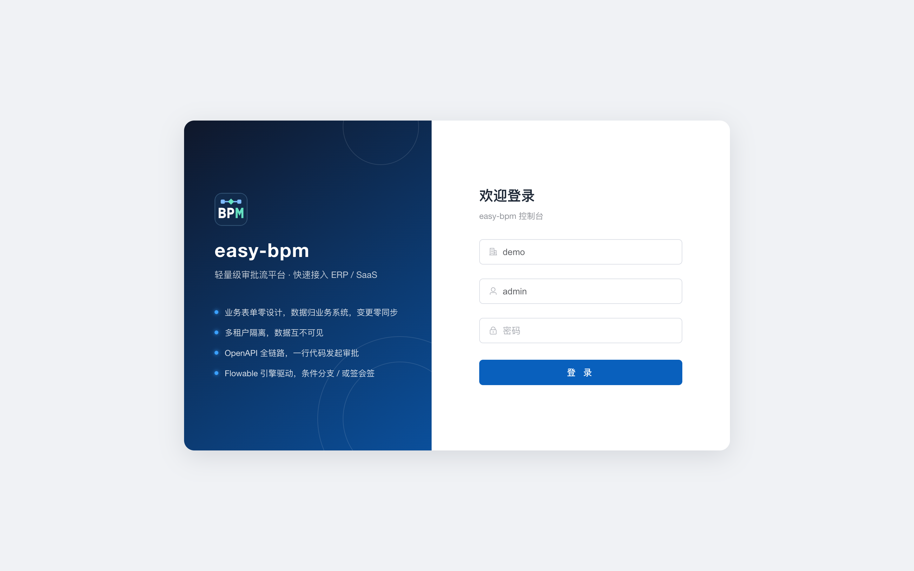

- 登录需要三项：**租户编码 + 账号 + 密码**。租户编码决定进入哪个租户的数据空间，跨租户数据完全隔离。
- 演示环境：租户 `demo`，账号 `admin / admin123`；平台管理员：租户 `platform`，账号 `platadmin / admin123`。
- 登录成功后签发 JWT（HS256，默认 12 小时），前端存于 localStorage，请求以 `Authorization: Bearer` 携带。
- 租户启用**企业单点登录**（SSO）时，输入租户编码后会出现「使用 xxx 登录」按钮，点击整页跳转到企业 IdP，无需输入密码。
  首次登录若提示「尚未开通控制台账号」，说明管理员还没把你的企业身份绑定到控制台账号，见 [sso.md](sso.md)。
- 平台管理员账号不建议设为 SSO 专属，避免 IdP 故障时无法进入平台管理。

---

## 2. 仪表盘

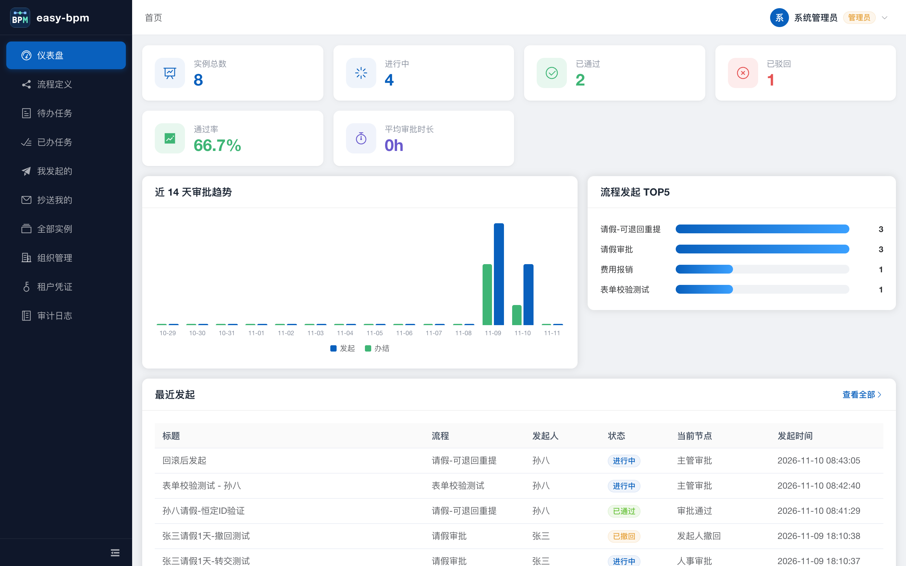

- **顶部统计卡**：实例总数、进行中、已通过、已驳回；管理员额外可见**通过率**与**平均审批时长**。
- **近 14 天审批趋势**：蓝柱为发起量、绿柱为办结量，悬停显示当日数值（纯 CSS 绘制，无图表库依赖）。
- **流程发起 TOP5**：按流程统计发起量，用于识别高频审批场景。
- **最近发起**：最新 8 条实例，点击行直达审批详情。

---

## 3. 流程定义

### 3.1 流程列表

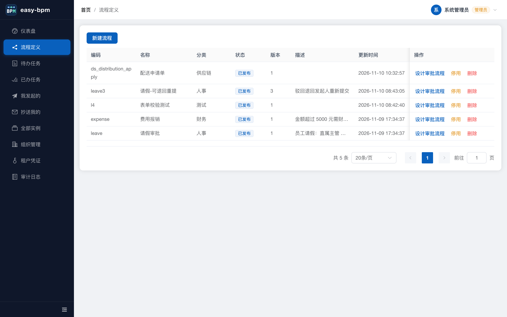

- 分页展示全部流程定义（草稿 / 已发布 / 已停用），支持名称与编码搜索。
- 操作列按状态收敛：`草稿` → 设计、发布、删除；`已发布` → 设计（改后重新发布）、停用；`已停用` → 启用（不产生新版本）。
- 启用/停用语义区分：**停用**让已发布流程不再可发起；**启用**恢复停用流程，不产出版本。

### 3.2 审批流程设计器

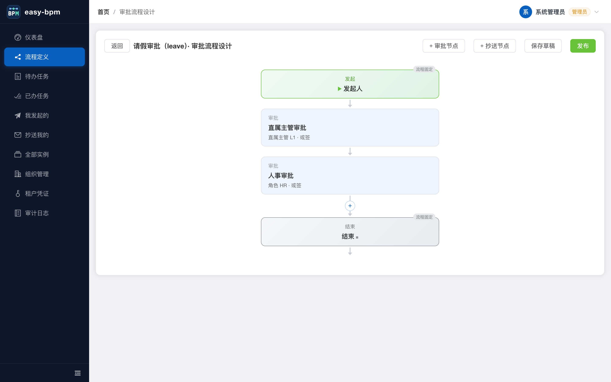

- 可视化编排：`发起人` → 若干审批/抄送节点 → `结束`。发起与结束为固定节点（绿/灰特殊配色 + 「流程固定」角标），不可编辑。
- 节点间以箭头连接，箭头上的 **＋** 即在两位插入新节点；点击已有节点可再次编辑属性。
- 审批人类型：指定人员 / 指定角色 / 发起人直属主管（支持 N 级）/ 部门主管 / 表单字段 / 发起人本人。
- 审批方式（或签 / 会签）、驳回策略（直接结束 / 退回发起人）、**审批人为空兜底**（拦截 / 自动通过 / 自动驳回）均为必填配置。
- 「发布」= 先存草稿再编译 BPMN 部署，发布即生成新版本，运行中实例不受影响。

---

## 4. 工作台

### 4.1 待办

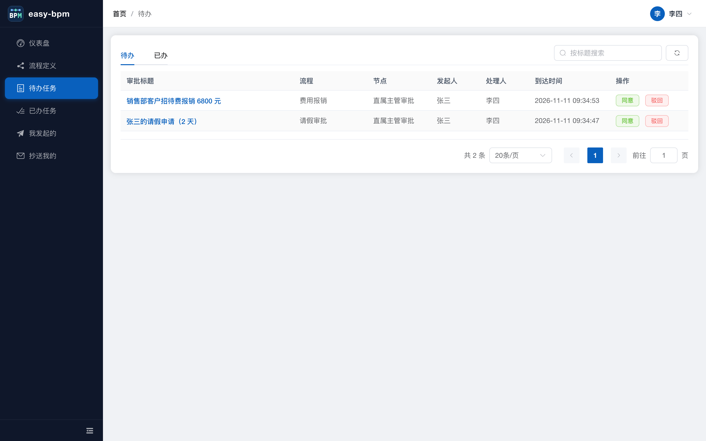

- 只展示“当前轮到我一票”的任务；支持流程/标题筛选，行点击直达审批详情。
- 快捷同意/驳回按钮直接内联处理，避免多跳一层；弹出框可填写审批意见。

### 4.2 已办

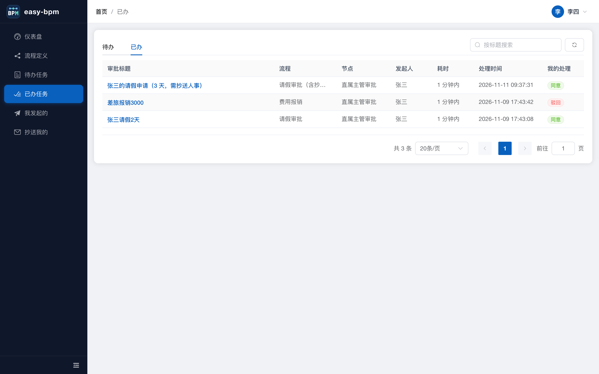

- 展示我处理过的任务及处理结果（同意 / 驳回 / 转交 / 撤回配色区分），并给出**耗时**（处理时间 - 到达时间，自适应分钟/小时/天）。
- 时间列统一 `yyyy-MM-dd HH:mm:ss`（后端 Jackson 全局序列化）。

### 4.3 我发起的

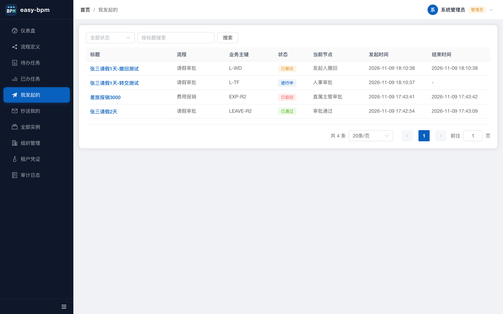

- 自己提交的全部实例，含运行中 / 已通过 / 已驳回 / 已撤回 / 已取消状态，可对运行中实例执行**撤回**。

### 4.4 抄送我的

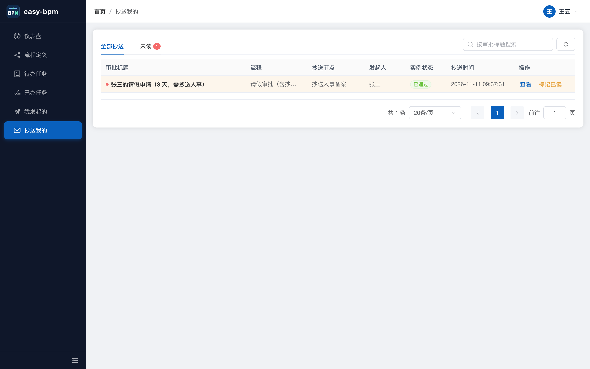

- 抄送节点执行后自动进入此页。未读行橙色底纹 + 标题加粗 + 红点，“未读” Tab 带未读数角标。
- 标记已读仅作用于本人（幂等），未读数随 `counts.ccUnread` 递减；接入方也可用 OpenAPI `/open/v1/cc` 在自己的消息中心实现红点。

---

## 5. 全部实例（管理员）

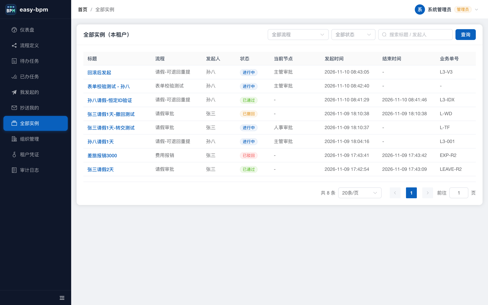

- 与"我发起的"区别：**全租户**实例，不限于本人。支持流程、状态过滤，关键字同时匹配**标题与发起人姓名**。
- 典型用途：代查某单据进度、定位卡住的实例、核对业务系统与 BPM 的数据一致性。
- 仅 `TENANT_ADMIN` / `PLATFORM_ADMIN` 可见，接口侧同样有权限守卫。

---

## 6. 审批详情

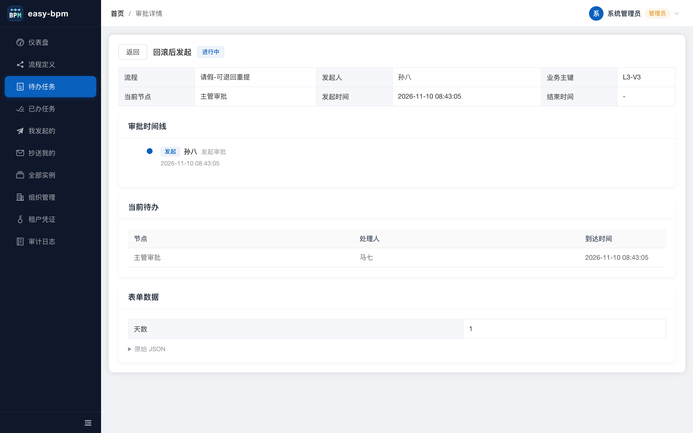

- 概要区：流程、发起人、当前节点、业务主键、起止时间。
- **审批时间线**：发起 / 审批 / 驳回 / 转交 / 撤回 / 抄送 / 自动通过全量留痕，含操作人与时间。
- **当前待办**：节点、处理人、到达时间，管理员可据此判断卡在谁那里。
- **表单数据**：按 `formSchema` 只读渲染（未提供 schema 时降级为键值对），并可展开原始 JSON。
- 待办人视角下此处出现同意/驳回/转交操作区。

---

## 7. 组织管理（管理员）

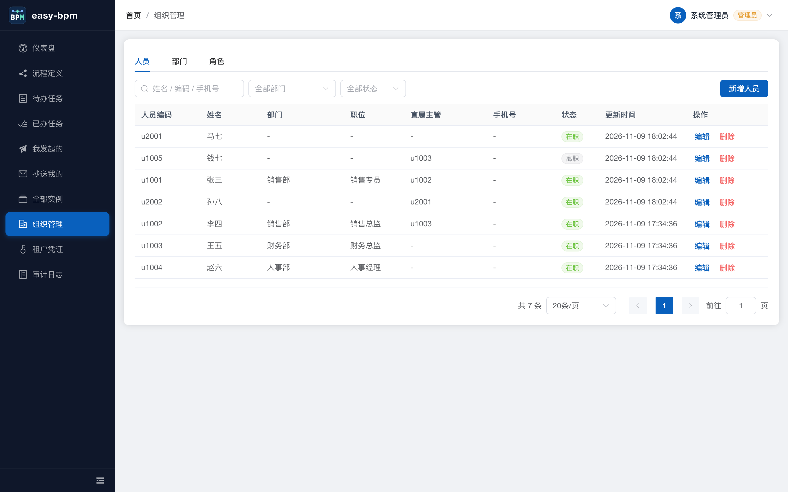

三个 Tab，数据既可由管理员在此维护，也可由业务系统通过 OpenAPI `/org/sync` 批量同步（同一套 upsert 语义，可混用）。

### 7.1 人员

- 新增/编辑：人员编码（唯一，创建后不可改）、姓名、部门、直属主管、职位、手机号、邮箱、状态（在职/离职）、角色（多选，可直接输入创建新角色）。
- **直属主管可留空**：留空时自动继承所在部门的主管（见下条规则），表单会动态提示当前部门对应的兜底主管。
- 列表"直属主管"列显示的是**生效主管**——继承自部门的会带「部门」小标签。
- 删除防护：被他人设为主管、或担任任一部门主管时不允许删除，提示先调整关系。
- 列表支持「姓名 / 编码 / 手机号」筛选：姓名与编码为模糊匹配；手机号落库加密，只支持**完整号码精确匹配**。
- 截图为演示数据，部分历史人员未归属部门，故「部门 / 直属主管」显示 `-`。

### 7.2 部门

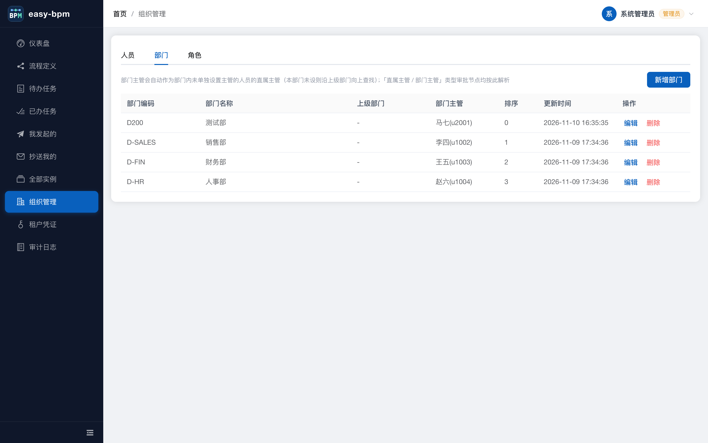

- 维护部门树（编码 / 名称 / 上级部门 / 部门主管 / 排序），主管从人员中选择。
- 删除防护：存在下级部门或部门下仍有人员时拒绝删除。

### 7.3 角色

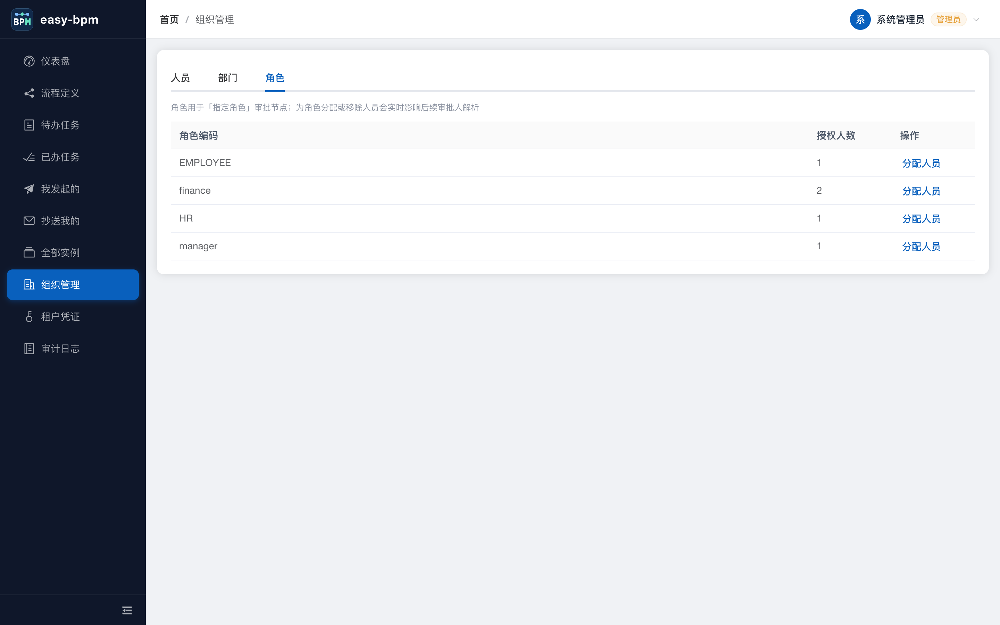

- 角色无独立维护页，随人员在"角色"字段中创建；「分配人员」弹窗预选现有成员，保存时按 diff 增删。
- 角色实时影响「指定角色」审批节点的人员解析，改完立即对**新发起**的实例生效（运行中实例的审批人已冻结）。

### 主管继承规则

「直属主管」类审批节点的解析顺序：

1. 人员**显式设置**的直属主管（用于跨部门汇报线）；
2. 未设置时，自动取**所在部门的主管**；
3. 本部门未设主管，则沿**上级部门逐级向上**找第一个配置了主管的部门；
4. 部门主管是**本人**时跳过本级继续向上，避免自己审批自己。

因此"部门设了主管"即等于"部门内所有人默认有了直属主管"，无需逐人重复维护。

---

## 8. 租户凭证（管理员）

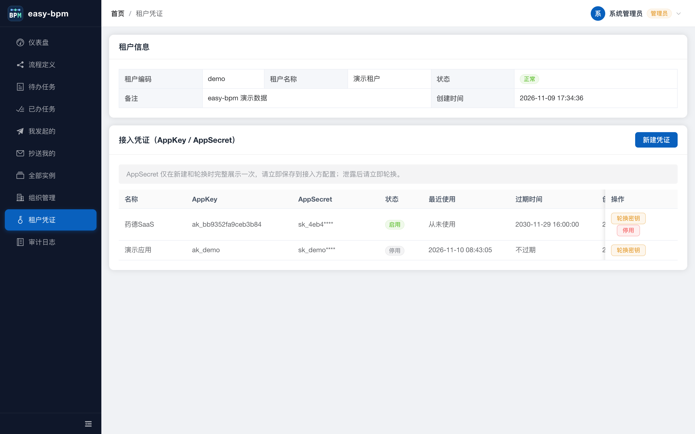

- 展示当前租户的 AppKey / AppSecret 列表：AppSecret 默认掩码，**创建或轮换时完整显示一次**，之后控制台不再提供查看入口，丢失只能轮换。
- 支持新建凭证、轮换（旧 Secret 立即失效）、停用 / 启用：**停用**后该凭证立即无法调用 OpenAPI；**启用**恢复调用且 AppSecret 保持不变，接入方无需改配置；已过期凭证需先轮换再启用。
- 建议一个接入系统对应一个凭证，便于分别吊销。
- 凭证用于 OpenAPI `X-App-Key` + HMAC-SHA256 签名鉴权，签名算法见 `docs/integration.md`。

---

## 9. 审计日志（管理员）

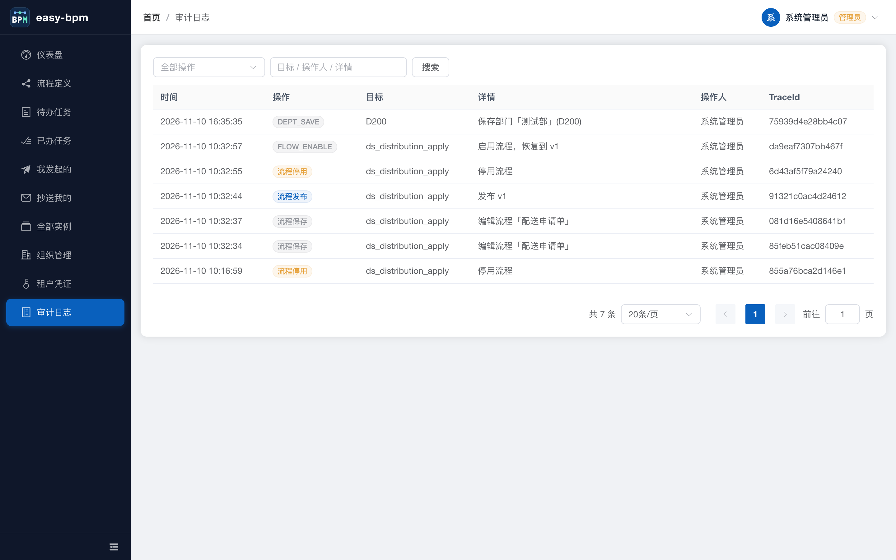

- 记录控制台敏感操作：流程保存/发布/停用/删除/回滚、凭证创建/轮换/停用/启用、租户新建/编辑/停用/切换、组织人员/部门/角色变更。
- 每条含操作人、目标类型与标识、描述与时间，便于合规追溯。

---

## 10. 平台管理（平台管理员）

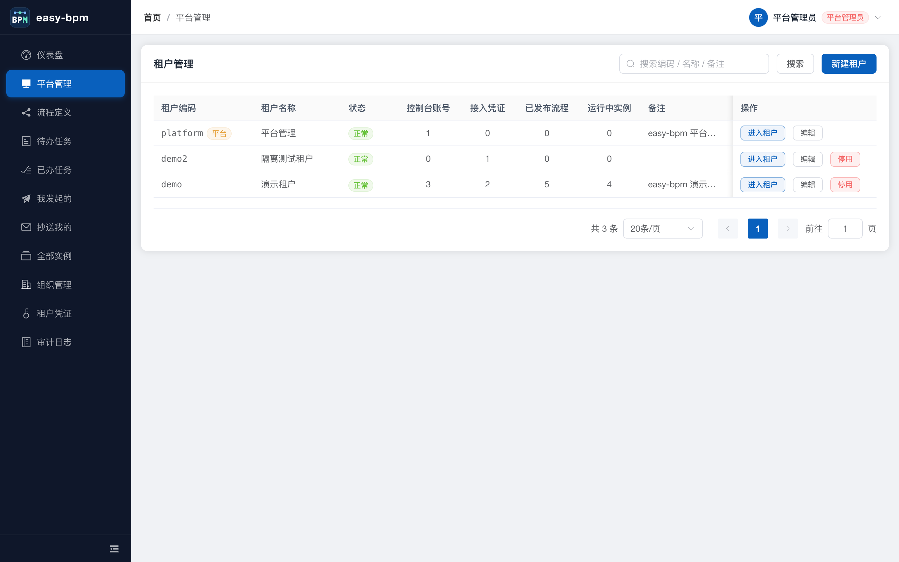

- 仅 `PLATFORM_ADMIN` 可见。用于**跨租户**运营：租户列表 + 统计（控制台账号数、接入凭证数、已发布流程数、运行中实例数）。
- 新建租户：可同时创建初始租户管理员（编码校验 + 同租户重名预检）；编辑、停用/启用（停用后该租户控制台登录与 OpenAPI 全部拒绝）。
- **进入租户**：以该租户视角查看数据，顶部常驻「管理中：租户名」标识，一键返回平台视角；切换动作写入审计（`TENANT_SWITCH`）。
- **SSO**：租户行的「SSO」按钮打开单点登录配置（Issuer / Client ID / Client Secret、测试连接）与「企业身份」绑定列表；
  员工首次企业登录后会出现在「待绑定」，选本地账号绑定并可选清空密码（仅允许企业登录）。见 [sso.md](sso.md)。
- `platform` 租户本身禁止停用，避免平台管理员把自己锁在门外。

---

## 11. 角色与权限矩阵

| 能力 | 普通用户 | TENANT_ADMIN | PLATFORM_ADMIN |
|---|---|---|---|
| 仪表盘（基础统计 / 最近发起） | ✅ | ✅ | ✅ |
| 仪表盘（通过率 / 平均时长 / 趋势 / TOP5） | ❌ | ✅ | ✅ |
| 流程定义与设计器 | ✅ | ✅ | ✅ |
| 待办 / 已办 / 我发起的 / 抄送我的 | ✅ | ✅ | ✅ |
| 全部实例 | ❌ | ✅ | ✅ |
| 组织管理（人员/部门/角色维护） | ❌（只读下拉可用） | ✅ | ✅ |
| 租户凭证 / 审计日志 | ❌ | ✅ | ✅ |
| 租户 SSO 配置与企业身份绑定 | ❌ | ❌ | ✅ |
| 平台管理（跨租户） | ❌ | ❌ | ✅ |

权限在前端路由守卫与后端接口两处同时校验，前端隐藏不作为安全边界。

---

## 附：界面与交互约定

- **时间格式**：后端全局序列化为 `yyyy-MM-dd HH:mm:ss`（`JacksonConfig`），前端 `fmtDateTime` 仅作兜底。
- **分页**：统一分页组件，默认 20 条/页，可选 10/20/50/100，右对齐。
- **表格交互**：斑马纹、整行可点击进入详情、操作列固定在右侧并阻断行点击冒泡。
- **空态**：所有列表均有独立空态组件与文案（如"没有未读抄送" / "暂无抄送"）。
